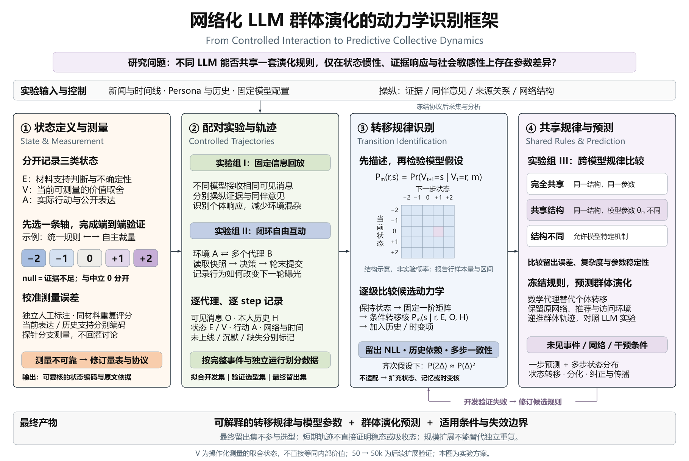

# Sim-Agent-1123-share

网络化 LLM 群体演化动力学

独立运行（Python 3.10+，无需额外安装依赖）：

```text
python run.py run --config configs/smoke.json
python -m unittest discover -s tests -v
python scripts/verify_smoke.py
```

初始化分支：`main`、`zkq`、`cjy` 使用同一份初始提交；后续可分别开发。旧实验档案属于外部可选材料，独立克隆可直接完成离线运行与测试。框架能力与限制见 [运行说明](docs/RUNNING.md)。

创建：2026-11-23（北京时间）

状态：已集成可运行的 v0.1 离线框架并通过工程验证；尚未启动正式 LLM 研究实验。
工程名：`llm-collective-dynamics`

> **核心目标：从新闻驱动的网络化 LLM 代理互动中，识别并验证可解释、可预测的群体演化动力学规律；检验不同 LLM 能否共享一套规则结构，仅在部分参数上不同，并明确该规律的适用条件和失效边界。**
>
> 平台建设、价值观评分、转移矩阵可视化和规模扩展，均为实现这一目标的手段。不能用“系统更完整”“热图更漂亮”或“节点更多”替代动力学规律的识别与验证。

## 1. 研究目标与论文主张

本研究面向新闻驱动的网络化 LLM 代理，建立区分证据判断、价值取舍与行动选择的状态测量框架。通过控制信息条件、同伴意见与网络结构，识别个体状态转移及其群体演化规律；进一步检验不同 LLM 能否由共享结构、模型特定参数的动力学模型描述，并验证该模型对未见事件、网络和干预条件下演化轨迹的预测能力。

优先检验的假设是：**不同 LLM 可以共享条件状态转移结构，其差异主要表现为状态惯性、证据响应、社会敏感性及历史依赖等参数差异。** 这是假设，不是预先认定的结论。

允许得到的结论包括：完全共享已经足够；共享结构但参数不同；某些模型需要额外机制；价值分档不足以构成一阶马尔可夫状态；规律仅在部分事件或网络条件下成立。应依据留出预测与干预验证选择结论，而非为预期主张筛选结果。

本工程首先研究 **LLM 代理的演化规律**。真实新闻和历史账号提供任务与环境依据，不自动赋予结果以人类社会规律的解释效力。

## 2. 核心研究问题

| 编号 | 研究问题 | 必须提供的证据 |
| --- | --- | --- |
| RQ1 | 哪些自然语言状态可以被可靠测量？ | 原文依据、独立标注、重复评分、null 与沉默等的处理 |
| RQ2 | 个体状态如何随证据、社会信息和本人历史转移？ | 配对输入、候选转移模型、历史依赖及多步一致性诊断 |
| RQ3 | 不同 LLM 是规则相同而参数不同，还是机制结构不同？ | 在相同信息条件下比较共享/独立模型，控制复杂度并做留出验证 |
| RQ4 | 微观转移规律能否预测群体演化及干预响应？ | 参数冻结后的网络递推，未见事件/网络/干预预测与误差边界 |

信息来源、转述背书、证据冲突、价值信息的额外解释力，作为 RQ1–RQ2 的诊断任务或条件变量展开，不另外扩张成互不连接的主线。

## 3. 从实验平台到动力学理论

主线：**状态定义与测量 → 配对实验与轨迹 → 转移规律识别 → 共享规律比较 → 群体预测验证。**



[可编辑 PPT 框架](docs/framework/llm-collective-dynamics-framework-v1-editable.pptx)

框架图中的矩阵仅是结构示意，不含实验概率。图和文档均表示计划，不表示所有模块已经实现或验证。

### 3.1 环境与代理

- **环境 A**：保存帖子、来源关系、网络和时间；控制访问、渠道、推荐与可见窗口；验证并轮末统一提交行动。
- **个体代理 B**：只读取本轮可见信息和本人可用历史，形成判断与取舍，输出行动及选择公开的表达。一套 A 中运行多个 B。
- **A → B**：个体可见消息、可见来源关系、社会线索及可行动作。不直接发送隐藏的真实多数分布。
- **B → A**：动作、目标帖子、渠道、公开文本和引用。私人判断、测量探针和内部记录不自动成为公共消息。
- **分析与评估**：只读日志；主实验中不将裁判分数反馈给代理。若未来研究评分反馈，必须将其作为单独干预条件。
- **动力学识别层**：由状态轨迹估计转移规律，冻结参数后在保留环境机制的条件下预测新轨迹。

### 3.2 状态与信息定义

| 记号 | 操作定义 | 边界 |
| --- | --- | --- |
| E(i,t) | 对给定材料支持程度及不确定性的判断 | 材料支持不等于现实世界真伪；客观语气不保证正确 |
| V(i,t) | 指定决策对象与价值轴上的可测量取舍 | 先称取舍状态；跨情境、撤除压力后仍保持，才进一步讨论稳定偏好 |
| A(i,t) | 实际行动 | 与口头意愿、选项概率和自由表达分别记录 |
| O(i,t) | 本轮实际可见消息及可见来源、社会线索 | 与环境全局状态分开 |
| H(i,t) | 本人截至该步允许使用的历史 | 记录历史截断、记忆更新与摘要版本 |

首轮选择 **统一规则—自主裁量** 一条轴，候选分档为 `-2,-1,0,+1,+2`。不直接映射为政治左右；强档位要求有明确的代价接受证据。先完成单轴端到端验证，再考虑总体收益—弱势优先、效率—程序保障等扩展。

`0` 是明确混合或权衡状态；`null` 是对应测量缺少立场证据，不能当成 0。未上线、沉默、协议无效、接口失败和标注缺失分别编码。不能把无发言自动当作状态保持，也不能把沉默自动解释为旧立场撤回。

优先独立建模各轴及行为，避免直接构造五档的多轴笛卡尔积导致状态稀疏。潜在状态模型/HMM属于后续候选，不能代替可靠标注与噪声识别。

## 4. 动力学候选与模型选择

### 4.1 从经验矩阵开始

对固定模型配置 m 与固定条件，描述性估计：

`P_m(r,s) = Pr[V(i,t+1)=s | V(i,t)=r, m]`

模型配置包括骨干版本、system prompt、采样设置、动作接口、记忆协议与环境约定。不能将这些条件共同造成的差异全部称为模型固有属性。

每行同时报告起始状态样本量、有效转移数、缺失与不确定性。未覆盖的行标记为不可估计；平滑是估计假设，不是观测到的转移。混合不同事件/条件/step所得矩阵可能掩盖异质性，先分层检查再决定是否合并。

同时区分“活跃决策时刻的转移核”和“每个时钟 step 的总体变化”。作息与离线机会可能提高表面自保持率，不能直接归因于价值惯性。

### 4.2 逐级比较，不预设一阶假设成立

| 候选 | 输入与结构 | 检验作用 |
| --- | --- | --- |
| K0 状态保持 | 下一步保持已知当前状态 | 排除低变化率造成的虚假高分 |
| K1 固定一阶矩阵 | 当前状态 | 最简单动力学描述 |
| K2 条件转移核 | 当前状态 + E/O + 预先定义的历史特征 | 识别证据、同伴与历史响应 |
| K3 增强动力学 | 高阶历史、时变项或必要的潜在状态 | 检查低维状态遗漏与非平稳性 |

K2可先采用可解释的多项/有序转移回归；是否适合有序约束需要验证，不默认禁止跨档位跳转。候选复杂度必须与独立样本量匹配。

在固定且齐次的假设下，可比较 `P(2Δ)` 与 `P(Δ)^2` 等多步一致性。时变或条件过程需要沿条件序列递推，不机械使用固定矩阵幂。一次一致性检验不能证明马尔可夫性。

完整微观系统的马尔可夫描述，不意味着五档价值或群体占比也具有马尔可夫性；若状态过粗，增加有依据的状态变量或报告近似失效，而非强行解释。

### 4.3 共享规律与模型差异

| 假设 | 定义 |
| --- | --- |
| S0 完全共享 | 同一结构、同一参数 |
| S1 共享结构 | 同一结构 f，模型特定参数 θ_m；可比较部分共享/分层估计 |
| S2 模型特定结构 | 允许额外机制或不同结构 |

候选参数包括状态惯性、证据响应、可见同伴信号敏感性和历史依赖。系数首先是条件关联；需要相应受控干预才能支持因果机制解释。

评价共享程度时同时考虑留出一步 NLL/校准、多步预测、复杂度、参数不确定性与跨事件稳定性。训练集拟合更好或参数显著不自动证明存在不同机制。

## 5. 分阶段实验计划与验收

正式研究阶段均尚未验收；已有离线运行框架和 E23 只读导入不等于完成测量校准或动力学实验。旧实验仅按其已有证据复用。阶段门槛是转入下一阶段的条件，不是必须得到正结果。

| 阶段 | 工作 | 产物 | 进入下一阶段的条件 |
| --- | --- | --- | --- |
| P0 范围冻结 | 冻结主轴、测量对象、首批事件、协议、候选模型、划分与预算 | 研究协议与事件/配置清单 | RQ、可反驳假设、主指标、对照与判定标准均明确 |
| P1 测量与旧轨迹审计 | 校准独立标注、重复评分，审计 E23/E26/E29 | 编码协议、逐例依据、噪声/覆盖/缺失报告 | 对主轴方向/强度/层级的可靠性达到预先冻结标准；否则迭代测量 |
| P2 固定信息回放 | 配对模型，分开操纵证据、同伴意见和来源关系 | 条件响应轨迹与转移统计 | 状态覆盖、独立重复和条件可比性支持候选估计；不足则缩小状态或追加样本 |
| P3 闭环采集与识别 | 多次独立网络运行，比较 K0–K3、S0–S2 | 候选核、参数、模型选择与诊断报告 | 开发验证下参数与误差可解释；若失配，修订候选并保留记录 |
| P4 冻结后的群体预测 | 数学代理替代个体转移，保留环境，对未见事件/网络/干预递推 | 一步/多步轨迹、干预响应与失效报告 | 按冻结判定标准报告支持或不支持；不得凭终点相似替代路径验证 |
| P5 规模与外部验证 | 在验证充分后逐级扩展节点，比较近似与成本，审查真实数据对应 | 跨规模误差、成本、适用范围 | 不将数学代理50k推演等同于50k LLM真实运行；明确验证依据 |

### 实验组 I：固定信息回放（主要回答 RQ2–RQ3）

- 不同 LLM 接收配对事件、可见消息、来源标识与规定历史；固定回放使模型间差异不被各自生成的环境完全混淆。
- 固定证据改变同伴意见；固定同伴条件改变可靠新证据。来源独立性、背书/转述、冲突/撤回可构成最小对照。
- 控制消息长度、数量、事实内容和行动机会；不把“更多文本”直接解释为“更多独立证据”。
- 分别测量 E、V、A，不把合理风险取舍自动叫作错误从众。既测试对错误意见的抵抗，也测试接受可靠纠正的能力。
- 价值变量若用于解释行为，必须来自独立题目/历史或独立操纵，不能从目标行动反推后再解释同一行动。

### 实验组 II：闭环网络互动（主要回答 RQ2、RQ4）

- 环境 A与多个B轮末同步提交。日志保留曝光、引用与父帖、互动、网络、状态测量及输入配置摘要。
- 先冻结平台机制与节点规模，估计个体规律；再受控改变网络/来源/意见/记忆等因素，不同时更换整个系统版本。
- 对照固定回放与自由互动：前者识别响应，后者检验内生曝光与反馈放大。
- 对估计出的条件核做网络级递推，保留相关性；群体占比平均场近似需要另做误差检查。

### 实验组 III：共享规律与留出预测（主要回答 RQ3–RQ4）

- 比较完全共享、共享结构模型特定参数、模型特定结构；预定义候选与选型规则。
- 冻结参数后，对留出事件、网络结构及干预条件预测。测试划分须对应所声称的泛化目标。
- 比较路径、速度、转移和干预响应，而不只比较终点分布或拟合热图。
- 当前尚未决定具体骨干名单、预算、指标通过阈值与正式样本量；这些是 P0 的必填项。

### 试点设计（建议值，非正式样本量承诺）

从一条轴、2个模型、2个事件、每组50个代理、约20轮、每条件至少3次独立运行检查可行性；根据状态覆盖与参数区间决定扩样。该设计不能自动提供充分功效或长期稳态证据。

短轨迹先关注有限时间演化。若需稳态、吸收态、长期极化或恢复时间结论，另行设计足够长的轨迹和扰动检验，不由8或20轮直接外推。

## 6. 数据划分、指标与解释纪律

### 划分与统计单位

- 拟合开发集用于参数估计；验证集用于候选选择；最终留出集在协议冻结后使用，不参与调参。
- 不将同一轨迹的相邻step随机拆到训练/测试来证明泛化；事件、独立运行和代理身份可能需要分组隔离，按具体主张设计。
- 相连代理和同一轨迹内的step不是独立实验重复。区间与不确定性按独立事件/网络运行等适当层级计算。
- 看过最终测试结果后修改方法，需要将该集合转为开发材料，并另设未见测试集；不能反复使用同一留出集宣称验证。

### 分层指标

| 层级 | 优先报告 |
| --- | --- |
| 测量 | 独立标注符合度、分档/层级混淆、重复一致性、覆盖率、null与无效比例 |
| 个体转移 | 留出 NLL、概率校准、各起始状态表现、罕见转移区间、相对保持基线的收益 |
| 规律比较 | 复杂度、参数区间、跨事件稳定性、模型适配所需数据、共享假设预测代价 |
| 群体演化 | 各step状态分布误差、翻转/保持/纠正频率、社区分化、轨迹形状与响应速度 |
| 传播行为 | 触达、首发规模和时序；真实数据对应口径与模拟机制分开 |
| 工程成本 | 调用数、token、耗时、故障与重试；数学替代模型的加速及预测损失 |

具体主指标、最小有意义增益与通过阈值在 P0/P1 开始新结果采集前冻结，不能事后挑选。分布距离不等同机制正确；重复稳定不等同语义正确；行为拟合不等同人类认知效度。

## 7. 现有成果如何复用

父项目与本工程分开保存，不覆盖旧输入、结果、源码快照或旧编号。

| 已有成果 | 本工程用途 | 保留边界 |
| --- | --- | --- |
| E12–E19 | 推荐、社区、作息、有限曝光与日志机制 | 不把跨版本演进当成单因素消融 |
| E21 | 真实传播形状与规模的外部参照 | 不证明价值测量、真实连边或证据推理正确 |
| E22 | 判断与行动可能分离的探索线索 | 固定回放/自由讨论数值先统一统计口径；选项顺序敏感性需校准 |
| E23 | 讨论与无同伴的历史轨迹，可做覆盖与描述审计 | 原服务器批次单一模拟种子、每组50人8轮，不是充分长期动力学证据 |
| E24–E29 | 裁判、层级、历史聚合、单轮证据与噪声诊断 | 高稳定性不证明准确；当前轮与全历史测量对象不同 |
| 类Jev决策接口 | 可替换的低成本行动概率输出 | token概率不自动是人类行为概率；更换接口属于模型配置变化 |

现有入口：

- [旧实验档案](../experiments/README.md)
- [E23实验设计](../experiments/E23/01_实验设计.md)
- [价值观评审进度与现象](../experiments/价值观评审实验进度与现象.md)
- [E29总结](../experiments/E29/04_实验总结.md)
- [传播实验交接说明](../项目交接说明.md)

上述引用是历史证据入口，不表示已在本工程复算或重新验证。已有新闻目录、清洗事件与实际实验事件的数量口径分别记录。

## 8. 工程结构与实施顺序

```text
llm-collective-dynamics/
  README.md                 # 唯一研究主文档：目标、假设、计划、阶段门槛
  AGENTS.md                 # 本工程内的执行约束
  docs/framework/           # 本轮框架 PNG 与可编辑 PPT
  run.py                    # plan/run/audit-e23 统一入口
  configs/                  # JSON公共配置、smoke与模型接入示例；不保存凭据
  prompts/                  # 公开表达协议
  experiments/TEMPLATE.md   # 新实验先填写并冻结的协议模板
  logs/DECISIONS.md         # 研究决策、方案变更和阶段状态
  src/collective_dynamics/   # 配置、环境、代理、运行与只读审计；动力学待实现
  tests/                    # 离线与本机HTTP集成测试
  scripts/verify_smoke.py    # 整批配对、重复启动与只读来源验收
  data/                     # 数据索引与派生数据；外部原始材料默认只读
  outputs/                  # 每次运行的独立输出，按run_id归档
```

建议的代码实施顺序：

1. 定义统一轨迹/测量/缺失schema及输入配置、prompt、模型标识和哈希；实现离线审计。
2. 为旧 E23/E26/E29 编写只读导入适配器，保留原文、旧评分来源与观测范围。
3. 实现测量校准和分支探针接口；先产出P1报告，再估计正式转移规律。
4. 实现配对固定回放及共同运行日志；再接入环境A的闭环适配器。
5. 实现经验转移统计、K0–K3和S0–S2候选、按组划分及留出评估。
6. 实现网络递推与开发验证反馈，冻结后运行最终留出预测。

当前已有可运行的最小框架：配置继承与校验、小世界网络、作息、热度、双渠道有限曝光、背景/角色/历史装配、固定回放、轮末同步闭环、fixture与聊天接口、原子恢复、持久化请求、E23只读导入。源码迁移记录见 `data/legacy_sources.json`。环境并非完整E21复刻，背景Parquet准备与BGE-M3兴趣矩阵尚未迁入；测量校准、独立探针、E26/E29专用适配器、动力学拟合与留出预测尚未实现。

运行见 [运行与集成说明](docs/RUNNING.md)，验收见 [工程验证报告](docs/VALIDATION.md)。2026-11-23离线24组全部完成，共1,728条agent-step记录；12项测试通过，旧E23的10份文件只读导入得到900条测量记录。没有访问真实模型；这些工程结果不构成正式实验或P1测量可靠性证据。

### 近期最优先待办

- [ ] P0：确定首条轴、评分对象和冻结字段。
- [ ] P0：列出首批事件、模型配置、独立重复和调用预算。
- [ ] P1：构造独立标注集，覆盖层级、代价、撤回、沉默与不确定性。
- [ ] P1：审计旧轨迹的状态覆盖、重复评分噪声与缺失。
- [ ] P0/P1：冻结数据划分、主指标和阶段验收阈值。
- [ ] P2：仅在前置测量可用后开展配对信息实验。

## 9. 每项实验必须通过的立项检查

新增实验前使用 [协议模板](experiments/TEMPLATE.md)，回答：

1. 对应 RQ1–RQ4 中哪一项？将决定哪个动力学候选、参数或适用边界？
2. 可被推翻的假设是什么？什么结果会让我们缩小或放弃它？
3. 与最简单基线和现有实验相比，新增信息是什么？
4. 改变什么、固定什么？哪些变量是可见信息，哪些只是研究者掌握？
5. 状态与评分是否可靠？缺失、无效、沉默与离线如何处理？
6. 主指标、数据划分、独立统计单位和预设判断标准是什么？
7. 所需预算、阶段前置条件、停止与扩样规则是什么？
8. 如何保留输入、版本、日志和原文，以支持复核？

如果不能明确回答，就先澄清协议或取消该实验。新增界面、增加模型、叠加场景、做动画和扩到50k，均不能独立作为脱离上述目标的实验理由。

研究范围变化记录在 [决策日志](logs/DECISIONS.md)，并同步本文件；尊重用户后续明确调整，不让旧计划阻碍合理修订。

## 10. 实验执行与结果维护

- 原始数据、历史响应与配置快照只读；新方案新建run_id和输出目录。
- 正式远程推理沿用已有手动CMD启动偏好，除非用户对具体批次明确改变；本次建工程不触发API调用或付费实验。
- 离线审计、准备代码和配置可以先做；模拟响应必须标注为fixture，不得混入正式结果。
- 每次运行保留模型与接口版本、时间、种子、调用参数、prompt/输入哈希、缓存来源、重试和异常。
- 凭据通过环境变量或本地忽略配置提供，不进入文档、输出或框架资产。
- 记录负结果、不显著结果和失配；优先解释误差，再考虑扩大规模。
- 阶段状态与待办在本README和决策日志同步维护，避免再次按工程迭代堆出大量并列实验编号。

## 11. 首批理论阅读入口

- [Agent Based Models and Opinion Dynamics as Markov Chains](https://arxiv.org/abs/1108.1716)：微观过程、宏观投影与马尔可夫聚合的条件。
- [Opinion influence and evolution in social networks: a Markovian agents model](https://re.public.polimi.it/bitstream/11311/1076955/1/opinions_Automatica.pdf)：邻居影响与网络化转移率建模。
- [马尔可夫模型选择与验证](https://emma-project.imp.fu-berlin.de/latest/legacy-notebooks/methods/model_selection_validation/model_selection_validation.html)：多步一致性等诊断；借鉴验证思想，不直接照搬分子动力学的建模假设。

文献调研的任务是决定候选模型、可识别参数与检验条件，而不是以复现更多论文为目的无限扩充平台。
